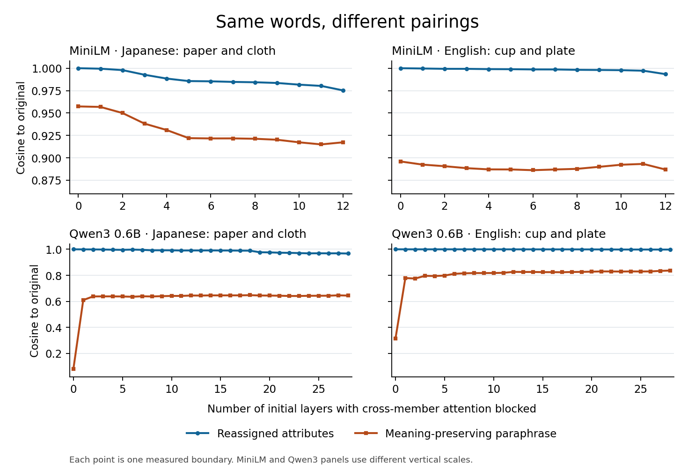

# 語の組み替えと言い換えの類似度

第2段階の測定値を再集計した。元の集合を基準とすると、モデル・層境界・例の組み合わせ2,262件すべてで、語を組み替えた集合のほうが意味を保った言い換えより近かった。ここでは、8モデルでトークンと位置をそろえられた境界選定用の色の例を日英から一つずつ取り上げる。 [実測の全体結果](RESULTS.md) · [例別の測定値](case-scores.jsonl)

| 言語 | 元の集合 | 色の組み替え | 言い換え |
|---|---|---|---|
| 日本語 | {`紙 : 赤`, `布 : 青`} | {`紙 : 青`, `布 : 赤`} | {`赤色の紙`, `青色の布`} |
| 英語 | {`cup : red`, `plate : blue`} | {`cup : blue`, `plate : red`} | {`a cup that is red`, `a plate that is blue`} |

[日本語の入力（binding-ja-development-01）](../../fixtures/set-context-ja-en-v2.json#L487) · [英語の入力（binding-en-development-01）](../../fixtures/set-context-ja-en-v2.json#L787)

## 層境界による変化

`k` は先頭から要素間アテンションを遮断した層数。表は元の集合とのコサイン類似度を、小数点以下6桁に丸めて「組み替え／言い換え」の順に示す。

| モデル | `k` | 日本語 | 英語 |
|---|---:|---:|---:|
| MiniLM | 0 | 0.999994 / 0.957350 | 0.999981 / 0.895962 |
| MiniLM | 6 | 0.985365 / 0.921640 | 0.998623 / 0.886216 |
| MiniLM | 12（全層） | 0.975197 / 0.917336 | 0.993409 / 0.886994 |
| Qwen3 0.6B | 0 | 0.999962 / 0.081780 | 1.000000 / 0.315796 |
| Qwen3 0.6B | 1 | 0.999417 / 0.609574 | 0.999826 / 0.778971 |
| Qwen3 0.6B | 28（全層） | 0.967518 / 0.644068 | 0.997963 / 0.836758 |



**MiniLM。** 日本語例で `k=0` から全層遮断にすると、組み替えの類似度が約0.025下がり、言い換えの類似度は約0.040下がった。そのため、組み替えの差を捉えやすくなっても、言い換えとの順位差は約0.043から0.058に広がった。この日本語例では、元の集合、組み替え、言い換えはいずれも特殊トークン込みで14トークンだった。

**Qwen3。** `k=0` から先頭1層だけ遮断すると、言い換えの類似度が日本語で約0.528、英語で約0.463上がった。組み替えの類似度はその時点でも両言語で0.999以上だった。最初の境界で順位差が縮まった分は、ほぼすべて言い換えの類似度の上昇で説明できる。全層遮断まで進めても、両例で組み替えが上位だった。

## 組み替えが近くなった理由

元の集合と組み替えでは、特殊トークンを含む `(要素内位置, トークンID)` の多重集合を一致させた。各要素の位置番号は0から始まり、すべてのトークンを同じシーケンスに入れる。追加遮断がない場合、別要素の同位置のトークンもモデル本来のマスクの範囲で参照できるため、アテンションで要素の所属を区別する手がかりが弱い。実際に、要素ごとの集約を省いて全要素の本体トークンを直接平均すると、`k=0` での組み替え前後のコサイン距離は、評価用の120組（8モデル×15例）で中央値0だった。最終出力では要素ごとに本体トークンを平均・正規化してから集合にまとめるため、同じトークン表現でも所属の変更が集合ベクトルに反映され得る。 [入力・マスク・集約の実装](../../experiments/set_context.cpp) · [自己アテンションの置換同変性（Set Transformer）](https://proceedings.mlr.press/v97/lee19d.html)

全層を遮断しても要素内のアテンションは残るので、「紙 : 赤」と「紙 : 青」のような結び付きの違いは要素ベクトルに反映される。評価用の120組すべてで全層遮断にすると組み替えは元の集合から遠ざかったが、言い換えとの順位差が縮まったのは70組だった。今回の言い換えには語順、助詞や冠詞、区切り記号などの変更が重なる。語彙・位置・書式の個別の寄与や、Qwen3の先頭1層の変化を生んだ具体的な内部機構は、この測定では特定できない。 [実測の全体結果](RESULTS.md)

## 数値の再取得

リポジトリのルートで実行すると、グラフの全境界の値を再取得できる。

```bash
jq -r '
  select(.split == "development" and (.model == "minilm" or .model == "qwen3"))
  | . as $row
  | .binding[]
  | select(.id == "binding-ja-development-01" or .id == "binding-en-development-01")
  | [$row.model, .id, $row.k, (1 - .swap_distance), (1 - .paraphrase_distance)]
  | @tsv
' results/2026-11-11-set-context-phase-2/case-scores.jsonl
```
