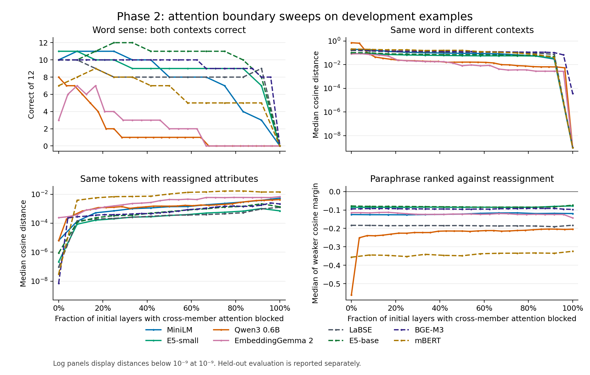

# 第二段階の実測結果

固定した8モデルを、Linux ARM64（Neoverse N1）上でCPU 4スレッド、1モデルずつ実行した。各モデルで境界選定用の語義12例と組み替え13例を全境界で測定し、評価用の語義12例と組み替え15例では、選んだ境界と両端を測定した。重み、入力、採点規則は[実験計画](README.md)のとおり。

## 評価用データでの成績

`k` は先頭から要素間アテンションを遮断した層数、`L` は全層数。各課題の選定境界は境界選定用データだけで決め、評価用では追加遮断なしの `k=0` と全層遮断の `k=L` も測った。同じ境界が選ばれた列には同一測定値を示す。

| モデル | 層数 | 語義の選定 k | 評価用の語義 k=0 / 選定 / k=L | 選定の日・英 | 組み替えの選定 k | 評価用の組み替え k=0 / 選定 / k=L |
|---|---:|---:|---|---|---:|---|
| `minilm` | 12 | 1 (8%) | 12/12 / 12/12 / 0/12 | 6/6・6/6 | 9 (75%) | 0/15 / 0/15 / 0/15 |
| `e5` | 12 | 0 (0%) | 8/12 / 8/12 / 0/12 | 5/6・3/6 | 12 (100%) | 0/15 / 0/15 / 0/15 |
| `qwen3` | 28 | 0 (0%) | 4/12 / 4/12 / 0/12 | 2/6・2/6 | 25 (89%) | 0/15 / 0/15 / 0/15 |
| `gemma2` | 24 | 2 (8%) | 5/12 / 6/12 / 0/12 | 5/6・1/6 | 4 (17%) | 0/15 / 0/15 / 0/15 |
| `labse` | 12 | 1 (8%) | 8/12 / 7/12 / 0/12 | 2/6・5/6 | 12 (100%) | 0/15 / 0/15 / 0/15 |
| `e5-base` | 12 | 3 (25%) | 10/12 / 9/12 / 0/12 | 5/6・4/6 | 12 (100%) | 0/15 / 0/15 / 0/15 |
| `bge-m3` | 24 | 2 (8%) | 10/12 / 10/12 / 0/12 | 6/6・4/6 | 19 (79%) | 0/15 / 0/15 / 0/15 |
| `mbert` | 12 | 2 (17%) | 8/12 / 6/12 / 0/12 | 1/6・5/6 | 12 (100%) | 0/15 / 0/15 / 0/15 |

### 語義と文脈

評価用では、追加遮断なしで8モデルすべてが語義を4〜12例判定できた。全層を遮断すると、全モデルで0/12になった。同じ語を二つの文脈に置いた場合のコサイン距離の中央値も、追加遮断なしでは0.086〜0.776、全層遮断では最大でも約0.000013だった。旧世代の多言語BERTとLaBSEでも、追加遮断なしでともに8/12、全層遮断で0/12となり、周囲の要素を参照できる条件で語義に対応した表現が得られた。

一部の層を遮断する効果はモデルごとに違った。選定した境界で評価用の正解が増えたのはEmbeddingGemma 2（5→6）のみだった。MiniLMとBGE-M3では同数、LaBSE・E5-base・多言語BERTでは減少した。Qwen3は追加遮断なしが選ばれた。Qwen3の同じ語の文脈間距離の中央値は `k=0` で0.776、`k=25` で0.000028だった。また、追加の遮断を外した層を含め、検査した未来位置への参照64件はすべて遮断された。

### 要素の組み合わせと順序

全8モデルで、トークンと位置をそろえた組み替えのコサイン距離の中央値は、全層遮断の方が追加遮断なしより大きかった。評価用では、追加遮断なしの各モデルの中央値が約 `2.6e-8〜2.6e-4`、全層遮断では `7.8e-4〜1.4e-2`。組み替えの差を検出できても、意味を保った言い換えがより近いとは限らなかった。選定用と評価用を合わせた170境界条件すべてで、言い換えを組み替えより両方向で上位に置けた例は0件だった。

日英の色の例について、元の集合と組み替え・言い換えの類似度を別々に追跡した。 [具体例の分析と全層境界のグラフ](BINDING-ANALYSIS.md)

入力順だけを変える検査は、各境界で選んだ例について延べ6,120通りの順序を比較し、文字列順に整列してから処理したベクトルはすべて成分ごとに一致した。整列を省いて反転したときの集合ベクトルのコサイン距離は最大約 `5.3e-4` だった。

## 工程ごとの時間

時間の単位は秒。選定用・評価用は入力検証から集計までの壁時計時間で、右側の工程は両分割で計測した時間を合算した。工程欄には重みのハッシュ照合やプロセス起動終了などの時間が含まれない。モデルごとに走査した境界数と評価用で選ばれた境界数が異なる。ピークRSSはLinuxの `getrusage` で分割ごとに記録し、各モデルの最大を載せた。

| モデル | 選定用（秒） | 評価用（秒） | 読込 | 初期化 | 参照 | 語義 | 組み替え | 集計 | ピーク RSS（MiB） |
|---|---:|---:|---:|---:|---:|---:|---:|---:|---:|
| `minilm` | 19.1 | 7.8 | 1.15 | 0.00 | 1.41 | 10.51 | 12.77 | 0.01 | 372 |
| `e5` | 20.3 | 4.8 | 1.17 | 0.00 | 1.30 | 10.79 | 10.85 | 0.01 | 372 |
| `qwen3` | 276.2 | 37.4 | 1.89 | 0.03 | 9.51 | 139.61 | 161.11 | 0.02 | 1160 |
| `gemma2` | 177.6 | 36.6 | 1.58 | 0.01 | 7.51 | 98.12 | 105.96 | 0.02 | 554 |
| `labse` | 34.7 | 9.0 | 1.82 | 0.00 | 1.94 | 20.23 | 18.38 | 0.01 | 685 |
| `e5-base` | 50.8 | 13.9 | 1.25 | 0.00 | 3.29 | 26.99 | 31.73 | 0.01 | 678 |
| `bge-m3` | 171.7 | 33.5 | 2.18 | 0.01 | 6.05 | 90.07 | 105.21 | 0.01 | 1053 |
| `mbert` | 29.0 | 8.0 | 0.60 | 0.01 | 1.90 | 14.98 | 18.83 | 0.01 | 301 |

16実行の全体時間は **15分31秒**（930.9秒）。2026年11月11日 04:45:10〜05:00:41 UTC。事前検証、アセットの取得、結果の図表作成はこの時間の範囲外。

## 測定値と再解析

- [境界ごとの集計](boundaries.jsonl)はモデル・分割・境界ごとに1行。全体と日英別の成績、中央値、語義参照を変えた場合の成績、文脈トークン数が等しい語義例での成績、各境界にかかった時間を含む。
- [例ごとの測定値](case-scores.jsonl)には語義のコサイン類似度とマージン、元の集合・組み替え・言い換えの比較、物理的に入力順を反転した場合の距離、マスク検査を保存した。入力文字列は[固定入力](../../fixtures/set-context-ja-en-v2.json)のIDから引ける。ベクトル成分を使う再解析には推論の再実行が必要。
- [実行と時間の記録](measurements.json)にワーカーID、実行ファイルと準備計画のSHA-256、各モデルの開始・終了時刻とメモリ、事前に固定した入力のハッシュ、ローカルの出力・ログのハッシュを保存した。
- [LaBSEのトークン化の照合](measurements.json)では、単独入力381文字列のうち日本語44件で今回のGGUFと公式トークナイザーのID列が異なった。LaBSE行の数値は今回のGGUFを使ったときの結果であり、公式トークナイザーやDense＋Tanhを使う構成は測っていない。

本測定は手作業で作成した短い入力での比較である。語義の選定用と評価用で難しさは異なり、組み替え例には元の集合とトークン多重集合が完全に一致する強い負例を使った。年代、学習目的、アーキテクチャ、量子化を独立に変えていないため、このデータから年代や学習目的の効果を分離することはできない。
