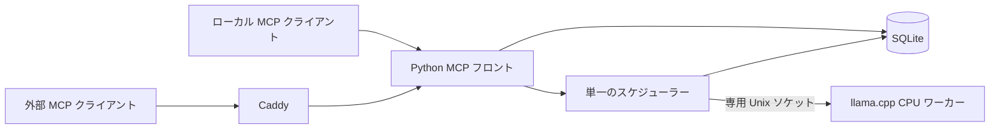

# Embedding MCP の設計

CPU 上でモデルの埋め込みとアテンションの変更を比較できるように、MCP の受付・ジョブ管理と、llama.cpp の推論を別プロセスにしています。短い比較は同期ツールで完結し、大量の比較はプロセスの再起動をまたいで続けられます。使い方と起動コマンドは [サービス README](README.md) にあります。

| 変更の種類 | 主な変更箇所 |
|---|---|
| MCP ツール、接続、入力と出力の型 | [main.py](main.py)、[contracts.py](contracts.py) |
| キュー、モデルの切替、メモリ解放 | [runtime.py](runtime.py) |
| ジョブの保存と復旧、メディア登録 | [storage.py](storage.py) |
| トークン展開、マスク適用、モデル推論 | [llama.cpp のパッチ](native/)、[ビルド処理](build_worker.py) |
| プロセス監督、公開ルートとランディングページ | [systemd と Caddy の設定](deploy/)、[静的ファイル](web/) |

## 推論とアテンション

モデルとビルドの出所を再現できるように、[アセットロック](../assets.lock.json) と [上流ソースの固定情報](native/upstream.json) を Git で管理します。フロントは起動時にワーカーのリリースを解決し、そのリリースを使い続けます。ワーカーのロード時に実行ファイルと対象モデルのハッシュを照合します。

`inspect_input` は、ワーカーが実際に使うトークン列を展開して位置表を返します。`layout_id` はエンジン・モデルなどの識別情報と、入力、トークン、位置表から計算します。生の位置範囲を指定するマスクはその ID を必要とし、別の入力に誤適用するとエラーになります。メディアの検証と登録は Python 側で行い、位置の確定は Gemma 2 がメディアを展開するワーカー側で行います。

マスクは埋め込みバックボーンのモデル既定値を起点に、指定された層・クエリヘッド・クエリ位置・キー位置の辺に適用します。重なるルールは後勝ちです。比較時は同一入力と同一リリースでマスクなしの結果も取り、プーリング、L2 正規化、メディア前処理の条件を揃えます。追加マスクの割当には256 MiBの上限があります。モデルの次元数と上限は [モデル定義](contracts.py) で管理します。

## CPU ワーカーの寿命と優先順位

モデルが複数同時に常駐すると CPU とメモリを取り合うため、スケジューラーが CPU ワーカー1個、推論スロット1個を管理します。同じモデルの入力はロード済みのプロセスを再利用します。モデルが変わると切り替えます。Gemma 2 のメディア入力に必要な projector 付きプロファイルは、ロード後にテキスト処理にも再利用できます。

モデルをロードするのは入力検査、同期埋め込み、永続ジョブの項目処理です。ツール一覧、状態、保存結果の取得はロードを起こしません。標準設定では、モデルを最後に使ってから300秒経過するか、ホストの `MemAvailable` が3 GiBを下回ると、処理中の項目を終えたところでワーカーを終了します。MCP フロントは接続を受け続け、メモリが回復すると待機中のジョブを再開します。

`embed_batch` は入力順を維持し、各項目のベクトルまたはエラーを返します。同期入力と永続ジョブは同じワーカーを使い、スケジューラーは項目の境界で同期入力を優先します。同期処理の80秒の期限にはキュー待ちとモデルのロードが含まれます。遅い呼び出しは、Caddy の POST 所要時間とアプリの `Loaded worker` ログを照合すると初回ロードの影響を見分けられます。

## 永続ジョブの復旧

- 受付時に入力、出力形式、モデル、実行環境の識別情報を SQLite に保存します。結果は項目ごとに進捗と同じトランザクションで確定します。
- 起動時に `running` を `queued` に戻し、最後に確定した次の項目から続けます。取消処理中だったジョブは `canceled` になり、確定済みの結果を保持します。処理中の項目が確定前に中断した場合は、再開時にその項目を計算し直せます。
- 保存時と現在のエンジンやモデルなどの識別情報が違う場合は `identity_changed` で終了します。同じジョブの結果に異なる条件のベクトルが混ざるのを防ぐためです。
- 応答を受け取れなかった場合は、保持期間内なら冪等キー、モデル、入力、出力形式を変えずに再送すると同じジョブ ID を取得できます。結果はジョブに結び付いたカーソルで取得します。完了・取消・失敗したジョブの既定の保持期間は24時間です。

## 通信と運用の境界

MCP フロントはループバックで Streamable HTTP を受け、`POST /mcp` に JSON で応答します。独立した待ち受け用の GET と HEAD は Host と Origin の検査後に `405` を返します。常時開いた SSE 接続が以前は再起動時に応答未完了のエラーを起こしていたためです。`/health` はフロントのスケジューラーの生存を確認する入口です。推論まで確かめるにはツールを呼び出します。

外部 HTTPS の送信元制限は Caddy の `client_ip` が担当します。ランディングページは公開ルート `/`、ツールの入口は `/mcp` です。推論ワーカーの専用 Unix ソケットはフロントが使います。Caddy 経由の利用者と、トンネルを構成した場合の利用者は同じジョブとメディアの保管領域を共有します。状態参照と同期ツールには読み取り専用ヒントを付け、永続ジョブの登録・取消とメディア登録には書き込みを伴うヒントを付けます。

Caddy のアクセスログにはメソッド、ステータス、所要時間などが残り、ヘッダーとクエリ文字列は除去されます。ジョブの SQLite、モデルの重み、ランタイムの一時ファイル、ホストの秘密情報はそれぞれのローカル保存先で管理します。

## 設計を変更したときの検証

推論を変更した場合は、[検証スクリプト](verify.py) の `native` で固定した上流ランタイムとの出力比較とマスクの効果を確認します。フロントやジョブ処理の変更は `service` でマスク付き呼び出し、アイドル解放、メモリ圧迫からの復帰、ジョブの中断・復旧を確認できます。外部経路を変更した場合は、対象クライアントからの接続確認とホスト上の HTTPS 検証を区別して記録します。

初期実装でどこまで確認したかは [検証記録](../results/2026-11-09-embedding-mcp.json) にあります。作業を再開するときの確認順は [AGENTS.md](../AGENTS.md) を参照してください。
